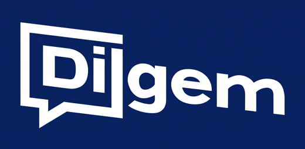

  

<h1 align="center">Altyazı Çevirici</h1>

  Videoyu verin; konuşmayı yazıya döker, altyazı yapar, çevirir ve isterseniz videoya gömer. 
  DİLGEM eğitim videoları için geliştirildi. · <a href="README.en.md">English</a>

---

## Ne yapar?

- 🎙️ **Konuşmayı yazıya döker:** Whisper ile, ekran kartında hızlı (1 saat 50 dakikalık bir eğitim yaklaşık 7 dakikada).
- 🌍 **Çevirir:** Türkçe ↔ İngilizce ve 30'dan fazla dil. Çevrimdışı çalışır; videolarınız bilgisayarınızdan çıkmaz.
- ✍️ **Gözden geçirtir:** Her altyazıyı videodaki görüntüyle birlikte görür, düzeltir, sesini dinlersiniz.
- 🎬 **Videoya gömer:** Altta ya da üstte, istediğiniz boyutta, isterseniz arka plan kutusuyla.
- 📂 **Toplu çalışır:** Videoları ya da bütün bir klasörü sürükleyip bırakın, gerisini o halletsin.

## 📚 DİLGEM Sözlüğü

Sıradan çeviri programları alan terimlerinde yanılır. Altyazı Çevirici, **8.400'ü aşkın kayıttan oluşan, DİLGEM'in alanlarına özel bir sözlükle** gelir.
Terimler önce **DİLGEM'in kendi eğitim materyallerinden**, sonra **Türkçe akademik literatürden**
seçildi: DSM-5 Türkçe, DergiPark makaleleri, üniversitelerin ergoterapi, fizyoterapi, dil ve konuşma
terapisi ve özel eğitim bölümlerinin yayınları, MEB 2018 Özel Eğitim Hizmetleri Yönetmeliği, resmî
Türkçe IDDSI belgesi, testlerin Türkçe uyarlamaları ve Türkçe araştırma yöntemleri kaynakları.

| Alan | Araştırılan terim | Örnekler |
|---|---:|---|
| Kısaltmalar ve meslekler | 423 | OT → ergoterapist, PT → fizyoterapist, SLP → dil ve konuşma terapisti, NICU, gölge öğretmen |
| Araştırma yöntemleri ve akademik dil | 648 | literatür taraması, sistematik derleme, randomize kontrollü çalışma, örneklem, etki büyüklüğü, hakemli dergi |
| Temel klinik bilgiler ve nörobilim | 630 | ayırıcı tanı, eş tanı, yaygınlık, nöroplastisite, prefrontal korteks, yan etki |
| Terapist, ebeveyn ve öğretmen dili | 522 | uyarı işaretleri, vaka yükü, tuvalet eğitimi, sakinleşme köşesi, engellenme toleransı |
| Psikoloji | 950 | zihin kuramı, yakınsal gelişim alanı, bilişsel ayrışma, felaketleştirme, WISC alt testleri |
| Dil ve konuşma terapisi | 623 | önleştirme, minimal çiftler, uyarılabilirlik, Lidcombe şiddet puanlama, IDDSI düzeyleri |
| Özel eğitim | 566 | BEP, kısa dönemli amaç, çoklu yoklama modeli, başlama düzeyi, uygulama güvenirliği |
| Fizyoterapi | 453 | eklem hareket açıklığı, gövde kontrolü, spastisite, GMFCS, kinezyo bantlama |
| Ergoterapi | 418 | duyusal modülasyon, praksis, dokunsal savunmacılık, KAPÖ, dinamik tripod kavrama |
| Otizm ve gelişimsel müdahaleler | 131 | JASPER: ortak dikkat, sembolik oyun, katılım; DIR Floortime iletişim çemberleri |
| Oyun terapisi | 105 | çocuk merkezli oyun terapisi, filial terapi, terapötik sınır koyma |
| Tanılar (DSM-5) | 82 | otizm spektrum bozukluğu, DEHB, özgül öğrenme bozukluğu |
| Değerlendirme araçları | 55 | AGTE, Denver II, WISC-R, TEDİL, Frostig |

Sözlük yalnızca kelime değiştirmez:

- **Adları korur:** DİLGEM, JASPER, Lidcombe, Landreth ve 220'yi aşkın yöntem ve test adı hep doğru yazılır.
- **Yanlış duyulanı düzeltir:** "Çocuk Merkezi Oyun Terapisi" → **Çocuk Merkezli**, "Filaterapi" → **filial terapi**.
- **Türkçe ekleri bilir:** *pekiştireci*, *öz düzenlemeyi*, *iletişim çemberlerini*, *panik bozukluğu olan*.
- **Gündelik sözcüklere dokunmaz:** "trunk" araba bagajıysa bagaj kalır, "calms" sakinleştirmektir.

Sözlük düz bir metin dosyasıdır; **Ayarlar ▸ Sözlüğü düzenle…** ile açıp kendi terimlerinizi
ve eğitmenlerinizin adlarını ekleyebilirsiniz. Terimlerin nasıl seçildiği ve tüm kaynaklar:
[docs/GLOSSARY.md](docs/GLOSSARY.md) · [docs/glossary_sources.tsv](docs/glossary_sources.tsv).

## Kurulum

**En kolayı – taşınabilir sürüm (kurulum yok):** [Releases](https://github.com/ullafreehum/subtitle-translator/releases/latest)
sayfasından **`AltyaziCevirici-…-portable-win64.exe`** dosyasını indirin, çalıştırın, bir klasör seçip
**Extract** deyin ve oluşan klasördeki **`SubtitleTranslator.exe`**'yi açın. Python ya da FFmpeg gerekmez.

**Kaynaktan kurmak isterseniz:**

1. Sağ üstteki **Code ▸ Download ZIP** ile indirin ve **sağ tık ▸ Tümünü ayıkla** deyin.
2. Klasördeki **`setup.bat`** dosyasına çift tıklayın. Gerekli her şeyi kurar ve masaüstüne bir kısayol koyar
   (bir kereye mahsus; yaklaşık 1,5 GB indirir).
3. Programı masaüstündeki **Subtitle Translator** kısayolundan ya da **`run.bat`** ile açın.

İlk videoda konuşma tanıma ve çeviri modelleri bir kez indirilir (yaklaşık 3 GB). Sonrasında internet gerekmez.
NVIDIA ekran kartı varsa onu kullanır, yoksa işlemciyle (daha yavaş) çalışır.

## Kullanım

1. Videoları pencereye sürükleyin ya da **Video ekle…** düğmesine tıklayın.
2. **Hedef diller** listesinden çeviri dilini seçin (Türkçe, İngilizce…).
3. İsterseniz **Altyazıları yeni bir videoya göm** seçeneğini işaretleyin.
4. **▶ Başlat**'a tıklayın. Altyazı dosyaları (`.srt`) videonun yanına kaydedilir.
5. Biten videoya çift tıklayıp **gözden geçirin**: düzeltin, **▶ Oynat** ile dinleyin, **Kaydet ve videoya göm** deyin.

Arayüz Türkçe açılır; **Ayarlar ▸ Dil** menüsünden İngilizceye geçebilirsiniz.

## Lisans

Program kodu © DİLGEM. Çevrimdışı çeviri modeli **NLLB-200** (Meta) yalnızca **ticari olmayan**
kullanım içindir (CC-BY-NC 4.0). Konuşma tanıma: Whisper (MIT). Ayrıntılar, sorun giderme ve
geliştirici notları: [README.en.md](README.en.md) · [docs/ARCHITECTURE.md](docs/ARCHITECTURE.md).
